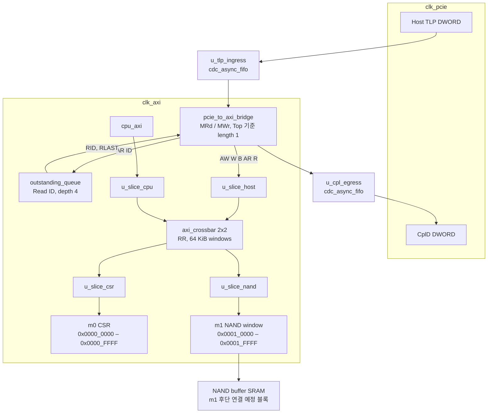

# AXI_PCIe_Subsystem

**AXI Multi-Layer Interconnect & PCIe Protocol Bridge**

NAND 컨트롤러 SoC에서 Host, 펌웨어 CPU, NAND 채널이 하나의 칩 안에서 연결되는 구조를 학습하며 정리한 서브시스템이다. PCIe 트랜잭션을 AXI로 변환하고, Multi-Layer Interconnect가 제어 평면(Control Plane)과 데이터 평면(Data Plane) 트래픽을 각 목적지 포트로 분배한다.

현재 저장소의 제어 평면은 `nand_sol_subsystem_top`으로 통합되어 있다. `clk_pcie` 도메인의 TLP는 **cdc_async_fifo**를 거쳐 `clk_axi` 도메인의 **pcie_to_axi_bridge**로 전달되며, 길이 1의 트랜잭션은 **AXI4-Lite Register Slice**와 **2x2 Crossbar**를 통과한다. Host Read ID는 **outstanding_queue**가 추적한다. PCIe PHY, 컨트롤러 본체, 데이터 평면의 Long Burst 규칙은 향후 과제로 남겨 두었다.

## 디렉터리 구조

```text
.
├── rtl/     합성 가능한 SystemVerilog RTL
├── verif/   Cocotb 테스트, BFM, 시뮬레이션 러너
├── asic/    Sky130 합성 스크립트, SDC, OpenSTA
├── docs/    아키텍처 노트, 주소 맵, 인터페이스 사양
└── sim/     시뮬레이션 빌드, 로그, 파형, results.xml
```

| 경로 | 역할 |
| --- | --- |
| `rtl/axi_register_slice.sv` | AXI4-Lite 5채널 Register Slice 및 채널 단위 Leaf 모듈 `axi_channel_reg_slice` |
| `rtl/axi_crossbar.sv` | 2x2 AXI4-Lite Crossbar. 주소 디코드, 슬레이브별 Round-Robin 중재 |
| `rtl/cdc_async_fifo.sv` | Dual-Clock FIFO. Gray 코드 포인터, 2단 Synchronizer `cdc_sync_2ff` |
| `rtl/pcie_to_axi_bridge.sv` | Memory TLP를 AXI4 INCR Burst로 변환. 요청 · 완료 경로별 FIFO 구성 |
| `rtl/outstanding_queue.sv` | AXI Read ID 추적. AR 시 슬롯 할당, R 시 슬롯 해제 |
| `rtl/nand_sol_subsystem_top.sv` | Bridge, CDC FIFO, Register Slice, Crossbar, Read ID Queue를 통합한 Top 모듈 |
| `verif/Makefile` | `sim` / `clean` 타깃. DUT 선택: slice, crossbar, fifo, bridge, top |
| `verif/run_sim.py` | Cocotb 1.8 / 2.x 호환 러너 |
| `verif/axi_lite_bfm.py` | 채널 Driver 및 Memory Slave 모델 |
| `verif/test_axi_register_slice.py` | Register Slice: 리셋, read/write, Back-pressure, 연속 처리량 |
| `verif/test_axi_crossbar.py` | Crossbar: 병렬 전달, Round-Robin, DECERR, AW/W 분리 수신 |
| `verif/test_cdc_async_fifo.py` | FIFO: full/empty, 포인터 동기화 지연, Wrap-around |
| `verif/test_pcie_to_axi_bridge.py` | 2DW Memory Write 이후 Memory Read의 CplD 확인 |
| `verif/scoreboard.py` | 예측 write/read 대비 슬레이브 바이트, CplD, 큐 Occupancy 비교 |
| `verif/test_subsystem_top.py` | Top: 1DW 요청의 MI0/MI1 분기 및 Read ID 추적 |
| `docs/architecture.md` | 클록 도메인 및 데이터 흐름 |
| `docs/cdc_design_note.md` | CDC 설계 원칙, Sky130 합성, Pre-layout STA |
| `asic/run_sky130.sh` | sv2v 변환 후 Yosys로 Sky130 HD 라이브러리에 매핑 |
| `asic/constraints.sdc` | `clk_pcie` 8 ns, `clk_axi` 10 ns, Asynchronous Clock Group 설정 |
| `asic/run_sta.sh` | 동일 Liberty 기반 OpenSTA Pre-layout 타이밍 분석 |

## 블록 다이어그램

Top 모듈 `nand_sol_subsystem_top`은 제어 평면을 하나의 모듈로 통합한다. `clk_pcie` 도메인은 Host TLP와 완료 DWORD만 담당하고, `clk_axi` 도메인은 Bridge부터 목적지 포트까지를 담당한다. 두 클록을 모두 사용하는 인스턴스는 `u_tlp_ingress`와 `u_cpl_egress`이다. 상세 설명은 `docs/architecture.md`에, CDC 및 타이밍 관련 내용은 `docs/cdc_design_note.md`에 정리했다.

```text
 clk_pcie                         clk_axi
 ────────                         ───────

 Host TLP DWORD
      │
      ▼
 ┌────────────────┐
 │ u_tlp_ingress  │  cdc_async_fifo
 │ Gray + 2FF     │
 └───────┬────────┘
        │
        ▼
 ┌──────────────────┐     outstanding_queue
 │ pcie_to_axi_bridge├──── AR 시 ID 할당
 │ MRd / MWr → AXI4 │◄─── R 시 ID 해제, RID/RLAST
 └────────┬─────────┘
          │ AW W B AR R, length 1
          ▼
 ┌────────────────┐     cpu_axi ──► u_slice_cpu ──┐
 │  u_slice_host  │                               │
 └────────┬───────┘                               ▼
          │                              ┌─────────────────┐
          └─────────────────────────────►│  axi_crossbar   │
                                         │  SI0 host       │
                                         │  SI1 CPU        │
                                         │  RR, 64 KiB     │
                                         └───┬─────────┬───┘
                                             │         │
                                             ▼         ▼
                                      u_slice_csr  u_slice_nand
                                             │         │
                                             ▼         ▼
                                      m0 CSR window   m1 NAND window
                                      0x0000_0000     0x0001_0000
                                      –0x0000_FFFF    –0x0001_FFFF
                                             │         │
                                             ▼         ▼
                                      CSR slave    NAND buffer SRAM
                                                   (향후 연결 예정 블록)

 완료 CplD
      ▲
 ┌────┴───────────┐
 │ u_cpl_egress   │  cdc_async_fifo
 └────▲───────────┘
      └── bridge completion, clk_axi → clk_pcie
```



데이터 평면(Burst AXI4)과 제어 평면(AXI4-Lite)은 Bridge 출력단에서 분기한다. Register Slice와 Crossbar는 제어 평면에 속한다. Bridge는 AXI4 INCR로 출력하며, `length==1`인 TLP는 single-beat 트랜잭션이 된다. Top은 이 single beat를 Register Slice와 Crossbar로 전달한다. 채널 Leaf 모듈은 페이로드 폭만 변경하면 데이터 평면 Register Slice에서도 동일한 Skid 구조로 사용할 수 있다.

## Subsystem Top

Top 모듈 `nand_sol_subsystem_top`에서 `clk_pcie`와 `rst_pcie_n`은 Host TLP 및 완료 경로에 연결된다. `clk_axi`와 `rst_axi_n`은 Bridge, Register Slice 4개, Crossbar, Outstanding Queue, CPU 포트, MI0, MI1에 연결된다.

요청 DWORD는 `u_tlp_ingress`를 거쳐 `clk_axi` 도메인으로 전달되고, 완료 DWORD는 `u_cpl_egress`를 거쳐 `clk_pcie` 도메인으로 반환된다. Bridge의 `pclk`와 `aclk`는 모두 `clk_axi`에 연결된다. Bridge 내부 FIFO는 동일 클록 도메인 안에서 헤더 다음에 페이로드가 오도록 순서를 보장한다.

Host AXI는 `u_slice_host`를 거쳐 Crossbar SI0에 연결된다. 펌웨어 CPU는 `cpu_axi_*` 포트에서 `u_slice_cpu`를 거쳐 SI1에 연결된다. MI0(`0x0000_0000`–`0x0000_FFFF`)는 `u_slice_csr`를, MI1(`0x0001_0000`–`0x0001_FFFF`)은 `u_slice_nand`를 거쳐 출력된다. Top에서 처리하는 TLP 길이는 1이며, 이때 `AWLEN`과 `ARLEN`은 0이다.

## Outstanding Queue

`outstanding_queue`는 `clk_axi` 도메인에서 Host AR Handshake가 발생할 때마다 ID와 주소를 슬롯에 저장한다. 슬롯이 모두 차 있거나 동일 ID가 이미 Outstanding 상태이면 `alloc_ready`가 0이 되며, Top은 해당 AR을 전달하지 않는다. R Handshake 시에는 일치하는 ID의 슬롯을 해제한다. AXI4-Lite 슬레이브에는 RID가 없으므로, 큐가 가장 오래된 ID를 Bridge의 `RID`로 반환하고 `RLAST`를 1로 설정한다. 기본 깊이는 4이다. `oq_count`는 Host Read가 하나 진행 중인 동안 1이며, 완료되면 0이 된다. CPU 포트의 Read는 이 큐의 추적 대상이 아니다.

## AXI4-Lite Register Slice

`axi_register_slice`의 슬레이브 포트(`s_axi_*`)는 업스트림 마스터에, 마스터 포트(`m_axi_*`)는 다운스트림 슬레이브에 연결된다.

```text
 s_valid ──►┌──────────┐   ┌──────────┐──► m_valid
 s_data  ──►│ skid reg │──►│ out reg  │──► m_data
            └──────────┘   └──────────┘
 s_ready ◄── ~skid_full         ▲
                                └── m_ready
```

| 항목 | 사양 |
| --- | --- |
| 채널 | AW, W, B, AR, R 채널별 독립 구성 |
| Latency | 입력 Handshake 다음 클록에 출력 VALID |
| Throughput | 양단 READY 유지 시 클록당 1 beat |
| 타이밍 | VALID · 페이로드와 READY 간 Combinational Path 없음 |
| 페이로드 | ADDR+PROT, DATA+STRB, RESP 무변경 전달 |
| 파라미터 | `ADDR_WIDTH` 1..64 (기본 32), `DATA_WIDTH` 32 또는 64 (기본 32) |
| 리셋 | `aresetn` Asynchronous Assert, Synchronous Deassert. 제어 Flip-Flop만 리셋 |

다운스트림이 Stall되면 Skid 슬롯이 1 beat를 흡수하고, 업스트림 READY는 그다음 클록부터 Deassert된다. 다운스트림 Stall 사이클 수와 업스트림 Back-pressure 사이클 수는 동일하다. 주소 디코드, Outstanding 추적, 응답 변경은 이 모듈의 범위에 포함하지 않는다.

## AXI4-Lite Crossbar

`axi_crossbar`의 슬레이브 포트 `s0_axi_*`, `s1_axi_*`에는 업스트림 마스터 2개가, 마스터 포트 `m0_axi_*`, `m1_axi_*`에는 다운스트림 슬레이브 2개가 연결된다.

기본 주소 맵은 64 KiB 윈도우로 구성되며, `(addr & mask) == (base & mask)`를 만족하면 해당 윈도우에 Hit로 판정한다.

| 포트 | 기본 범위 |
| --- | --- |
| MI0 | `0x0000_0000` – `0x0000_FFFF` |
| MI1 | `0x0001_0000` – `0x0001_FFFF` |

어느 윈도우에도 해당하지 않거나 두 윈도우에 동시에 해당하는 주소는 요청한 마스터에 `DECERR`을 응답하며, 다운스트림으로 전달하지 않는다. 주소 맵은 `M0_BASE`, `M0_MASK`, `M1_BASE`, `M1_MASK` 파라미터로 변경할 수 있다.

마스터별로 write 1건과 read 1건이 동시에 진행될 수 있다. AXI4-Lite에는 ID가 없으므로 응답 순서는 재정렬하지 않는다. AW와 W는 각각 독립적으로 수신하고, 두 채널이 모두 도착한 뒤 동일한 슬레이브로 전달한다. 중재(Arbitration)는 다운스트림 슬레이브별로 write와 read를 독립적으로 수행한다. 서로 다른 슬레이브로 향하는 두 마스터의 요청은 병렬로 진행되며, 동일 슬레이브로 향하는 요청만 Round-Robin 방식으로 직렬화한다. Grant를 받은 마스터는 다음 중재에서 가장 낮은 우선순위로 이동하며, 해당 마스터가 B 또는 R 응답을 수신할 때까지 그 슬레이브의 해당 방향(write 또는 read)은 Lock 상태를 유지한다.

## CDC Async FIFO

`cdc_async_fifo`는 쓰기 클록과 읽기 클록이 서로 다른 Dual-Clock FIFO이다. 포인터는 자기 클록 도메인 안에서는 Binary로 관리하고, 상대 도메인으로 전달할 때만 Gray 코드로 변환한다. 각 방향의 포인터는 2단 Synchronizer `cdc_sync_2ff`를 거친다. `wr_full`은 쓰기 클록 도메인에서, `rd_empty`는 읽기 클록 도메인에서 생성한다. `rd_data`는 `rd_empty`가 0인 동안 FIFO Head의 값을 출력하며, `rd_en`으로 해당 워드를 Pop한다.

`DEPTH`는 4 이상인 2의 거듭제곱이어야 한다. `wr_rst_n`과 `rd_rst_n`은 동시에 Assert하고, 각 클록 도메인에 동기화하여 Deassert해야 한다. 쓰기 포인터가 읽기 도메인에 반영되려면 `rd_clk` 상승 에지가 최소 두 번 필요하다. 따라서 그 이전에 `rd_empty`가 Deassert된다면 동기화 경로를 우회한 것으로 판단할 수 있다.

## PCIe-AXI Bridge

`pcie_to_axi_bridge`는 PCIe MAC을 포함하지 않으며, 인접 블록이 `pclk` 기준으로 TLP를 DWORD 단위로 한 beat씩 전달한다. `tlp_sop`는 첫 번째 DWORD를, `tlp_eop`는 마지막 DWORD를 표시한다.

처리 대상 요청은 Memory Write와 Memory Read이다. 3DW 헤더와 상위 주소가 0인 4DW 헤더를 수용한다. 상위 주소가 0이 아니거나 Memory 요청이 아닌 TLP는 폐기하고, `tlp_error`를 1클록 동안 Assert한다. 최대 길이는 `MAX_DW`(기본 16)이다.

요청은 헤더 beat, 페이로드 순으로 요청 FIFO를 통과한다. AXI 클록 도메인에서는 beat 크기 4바이트의 AXI4 INCR Burst로 출력된다. Outstanding 트랜잭션은 한 번에 1개로 제한된다. Memory Write는 Posted 요청이므로 완료 TLP가 없다. Memory Read의 R 데이터는 AXI 클록 도메인에서 수집한 뒤 3DW CplD로 구성하고, 완료 FIFO를 통해 `pclk` 도메인으로 출력한다. 첫 번째 DWORD에서는 `cpl_sop`가, 마지막 DWORD에서는 `cpl_eop`가 1이 된다.

## 시뮬레이션 및 테스트

실행 환경으로 Python 3.9 이상, GNU Make, Cocotb 1.8 또는 2.x, 그리고 Icarus Verilog 12 이상 또는 Verilator 5 이상이 필요하다.

```bash
cd verif
pip install -r requirements.txt
make sim
make sim SIM=verilator WAVES=1
make sim DUT=crossbar SIM=verilator
make sim DUT=fifo SIM=verilator
make sim DUT=bridge SIM=verilator
make sim DUT=top SIM=verilator
make sim TESTCASE=test_reset_outputs_idle
make clean
```

`DUT`의 기본값은 `slice`이다. `make`를 사용할 수 없는 환경에서는 `python run_sim.py --sim icarus --dut fifo`와 같이 동일한 흐름을 실행할 수 있다. 파형과 `results.xml`은 `sim/` 아래에 생성되며, `slice` 이외의 빌드 결과는 `sim/build/<dut>/`에 별도로 저장된다.

| 테스트 | 검증 항목 |
| --- | --- |
| `test_reset_outputs_idle` | 리셋 후 VALID=0, 비어 있는 Slice의 READY=1 |
| `test_write_read_and_strobe` | 5채널 경유 write, byte strobe, read-back. 채널별 2클록 Back-pressure 인가 |
| `test_aw_backpressure_preserves_beats` | 다운스트림이 beat마다 4클록 Stall해도 AW 8 beat의 순서 및 개수 유지 |
| `test_aw_back_to_back_throughput` | READY가 1로 유지되면 Latency 1클록, 이후 클록당 1 beat |
| `test_parallel_masters_different_slaves` | 슬레이브 0이 Stall된 동안 슬레이브 1 트랜잭션이 먼저 완료 |
| `test_round_robin_on_shared_slave` | 동일 슬레이브 경합 시 다음 Grant는 직전 Grant 마스터가 아님 |
| `test_decode_error_does_not_stall_the_other_master` | 미매핑 주소는 DECERR 응답, 다른 마스터의 트랜잭션은 정상 진행 |
| `test_wdata_may_follow_awaddr` | W가 AW보다 늦거나 빠르게 도착해도 Strobe 유지 |
| `test_fill_sets_full_and_extra_write_is_dropped` | 슬롯이 모두 차면 full Assert, 이후 wr_en은 무시 |
| `test_empty_waits_for_write_pointer_sync` | empty는 rd_clk 2 에지 이후에 Deassert |
| `test_full_waits_for_read_pointer_sync` | 읽기 포인터가 wr_clk 도메인에 반영되기 전까지 full 유지 |
| `test_wrap_under_both_clocks` | 포인터 Wrap-around 이후에도 데이터 순서 유지 |
| `test_memory_write_and_read_cross_clocks` | 2DW MWr 데이터가 AXI 측에 기록되고, MRd의 CplD가 동일 데이터를 반환 |
| `test_single_beat_windows_track_read_id` | 1DW MWr/MRd의 MI0 · MI1 분기, CplD 및 `oq_count` 일치 |

## 향후 과제

- Interconnect 포트 수 확장(2x2 초과) 및 Multi-Layer · QoS 기능 추가
- 데이터 평면 AXI4 Long Burst 처리. 현재 Top의 큐는 제어 평면 Read ID를 깊이 4까지 추적
- PCIe PHY, DLL, 다중 Outstanding Completion
- MI1 NAND Buffer 후단의 NAND 채널 Multi-Port 분할
- 인터페이스 사양의 Register Map 정의

## 커밋 및 브랜치 규칙

`main` 브랜치에는 시뮬레이션을 통과한 Top만 유지한다. 기능 개발은 `feat/<block>` 브랜치에서 완료한 뒤 `main`에 병합한다. 커밋 메시지는 한 줄로 작성하며, 접두어는 다음과 같이 구분한다.

| 접두어 | 용도 | 예시 |
| --- | --- | --- |
| `feat:` | 신규 RTL 또는 신규 테스트 경로 추가 | `feat: add gray-code async fifo` |
| `fix:` | 시뮬레이션에서 확인된 오동작 수정 | `fix: index completion buffer with beat width` |
| `test:` | 검증 체크만 추가하는 경우 | `test: scoreboard checks subsystem completions` |
| `docs:` | README 및 `docs/` 문서 수정 | `docs: describe cdc and the control-plane path` |
